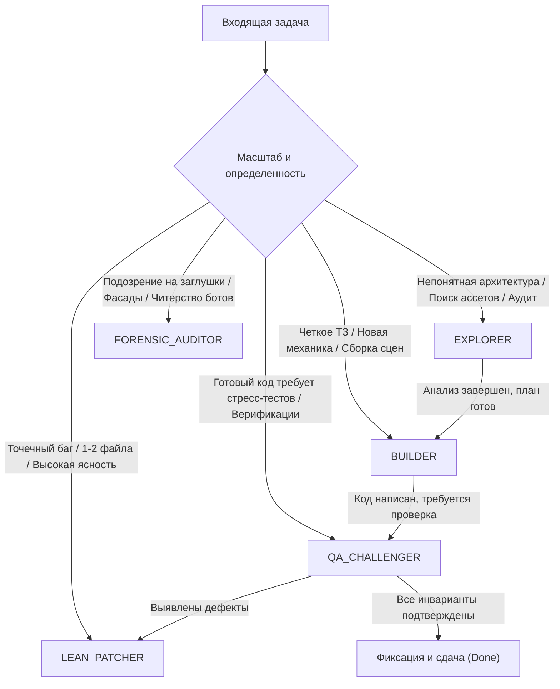

# Autonomous Agent Mode Selector (`agent-modes`)

Руководство по автономному выбору и смене режимов функционирования для ведущих агентов и субагентов.

---

## 1. Матрица автономного выбора режима (Decision Matrix)

Перед началом любой работы агент проводит экспресс-анализ задачи и активирует один из режимов:



---

## 2. Спецификация режимов работы

### Режим 1: `EXPLORER` (Исследование и аудит)
* **Цель**: Собрать факты, AST-дерево, карту зависимостей, проверить наличие ассетов в банке.
* **Строгий инвариант**: **READ-ONLY**. Запрещено модифицировать или создавать файлы исходного кода проекта.
* **Разрешенные действия**: `view_file`, `grep_search`, `find_by_name`, чтение `PROJECT_INDEX.md`.
* **Выходной артефакт**: Краткий аналитический отчет с точными путями к файлам, сигнатурами и планом изменений.
* **Связанные скилы для загрузки**: `project-indexer`, `godot-mcp`.

---

### Режим 2: `BUILDER` (Разработка и реализация)
* **Цель**: Чистая реализация механик, компонентов или сцен по согласованному плану.
* **Строгие инварианты**:
  1. Только типизированный код без скрытых типов (`Variant`).
  2. Никаких хардкод-заглушек или пустых методов `pass`.
  3. Не перезаписывать файл целиком, если меняется один метод — использовать точечный `replace_file_content`.
  4. **Zero-Hardcode & Inspector-First (Godot)**:
     - Запрещены строковые пути к ассетам (`preload("res://...")`, `load("res://...")`) и строковые пути к узлам (`get_node("A/B")`, `$A/B`).
     - Сменные ассеты (`AudioStream`, `Texture`, `PackedScene`) и внешние зависимости — строго через типизированные `@export`.
     - Обязательно использование `@export_group` / `@export_subgroup` и слайдеров `@export_range` с шагом и единицами измерения.
     - Для нелинейных зависимостей (ускорение, спад урона) использовать `Curve`.
     - Баланс и статы выносить в кастомные `Resource` (`.tres`). Внутренние инкапсулированные узлы сцены адресовать через Scene Unique Nodes (`%NodeName`).
  5. **Out-of-the-Box Ready + Fallback**: Префаб обязан запускаться автономно (F6) с назначенными ресурсами и связями. В коде обязательна защита от `null` с понятным `push_warning`.
* **Связанные скилы для загрузки**: `godot-architecture`, `godot-3d-pipeline` (если 3D/сцены), `token-economy`.

---

### Режим 3: `QA_CHALLENGER` (Стресс-тестирование и верификация)
* **Цель**: Найти скрытые баги, краевые случаи, утечки памяти, регрессии.
* **Строгие инварианты**:
  1. Обязательный запуск тестов в `--headless` консольном режиме Godot.
  2. Статический аудит на хардкод: запуск валидатора
     `python "C:\Users\Денис\.gemini\config\skills\godot-architecture\scripts\audit_zero_hardcode.py" <path>`
     (0 ошибок Zero-Hardcode допускается).
  3. Проверка запуска сцены (F6 / headless) с дефолтными ресурсами без падений по `null reference`.
  4. Проверка граничных условий: нулевой ввод, деление на ноль, уничтожение узла во время обработки, выход игрока из машины на полной скорости.
  5. В PowerShell скриптах всегда принудительно задавать UTF-8:
     ```powershell
     [Console]::OutputEncoding = [System.Text.Encoding]::UTF8
     ```
* **Выходной артефакт**: Протокол тестирования (Pass/Fail) с точными шагами воспроизведения (STR).

---

### Режим 4: `LEAN_PATCHER` (Точечный экономный фикс)
* **Цель**: Быстрое устранение одиночного бага без раздувания контекста и без запуска тяжелых цепочек субагентов.
* **Строгие инварианты**:
  1. Максимум 3 шага: найти строку -> применить патч -> проверить компиляцию/тест.
  2. Запрещено порождать субагентов (`invoke_subagent`).
  3. Запрещено вносить хардкод даже ради быстрого фикса — сохранять `@export` и структуру ресурсов.
  4. Ответ пользователю строго по формату: «В чем была причина -> Что исправлено -> Результат проверки».

---

### Режим 5: `FORENSIC_AUDITOR` (Аудит целостности)
* **Цель**: Проверка кода, написанного другими агентами, на предмет симуляции работы, хардкода результатов тестов или обхода политик ассетов.
* **Проверяемые маркеры**:
  - **Маркеры хардкода**:
    * Наличие строковых путей к файлам ассетов в коде: `preload("res://` или `load("res://`.
    * Использование строковых путей к нодам: `get_node("` или `$Path/To/Child` вместо `@export` или `%NodeName`.
    * «Голые» неорганизованные `@export var` без `@export_group` (при $\ge 3$ свойствах).
    * Магические числа в игровой логике вместо выноса в `@export` или кастомные ресурсы `.tres`.
    * Отсутствие проверки на `null` / fallback для экспортированных ресурсов.
  - Наличие фальшивых проверок вида `assert(true)`.
  - Генерация суррогатных SVG вместо использования официального банка ассетов.
  - Утечки `Node` из-за отсутствия `queue_free()`.

---

## 3. Протокол передачи режима субагентам (Subagent Mode Handover)

Если ведущий агент принимает решение вызвать `invoke_subagent`, он **ОБЯЗАН** включить в самое начало промпта декларацию режима и обязательные скилы:

```text
[ASSIGNED_OPERATIONAL_MODE]: BUILDER
[MANDATORY_INITIAL_SKILLS]:
1. View and apply: C:\Users\Денис\.gemini\config\skills\godot-architecture\SKILL.md
2. View and apply: C:\Users\Денис\.gemini\config\skills\godot-3d-pipeline\SKILL.md (if 3D/scenes)
3. View and apply: C:\Users\Денис\.gemini\config\skills\token-economy\SKILL.md

[INVARIANT]:
Follow Zero-Hardcode & Inspector-First standard strictly. All configurable stats in Resources or @export with @export_group.
Follow the BUILDER mode guidelines strictly.
```

---

## 4. Протокол интеграции со слэш-командами Antigravity

### 1. Команда `/grill-me` (Socratic Design Interview)
* **Активируемый режим**: `EXPLORER` $\rightarrow$ `SOCRATIC_GRILLER`.
* **Алгоритм работы**:
  1. Выполнить 0-токенную экспресс-индексацию через `project-indexer` для получения контекста репозитория.
  2. Запрещено сразу писать код или давать финальное решение.
  3. Формировать вопросы пакетами через интерактивный инструмент `ask_question` с вариантами выбора (multi-choice), покрывая 4 аспекта:
     - **Геймдизайн**: core loop, механика ввода, темп;
     - **Архитектура**: компонентная модель, шина сигналов, персистентность;
     - **Баланс**: кривые, диапазоны параметров, экономика;
     - **QA / Edge Cases**: обработка паузы, рестарта, нулевого ввода, потери фокуса.
  4. После ответов сформировать краткий `Feature Specification Plan` и запросить утверждение.

### 2. Команда `/boost` (Deep Multi-Perspective Reasoning & Verification)
* **Активируемый режим**: `DIALECTIC_VERIFIER` (`EXPLORER` + `QA_CHALLENGER`).
* **Алгоритм работы**:
  1. Развернуть анализ по схеме: **Гипотеза Архитектора** $\longleftrightarrow$ **Контраргумент QA/Безопасности** $\longleftrightarrow$ **Синтез**.
  2. Строгий запрет на чисто теоретические выводы в сложных случаях: создавать минимальный scratch-скрипт верификации (`scratch/verify_boost_*.gd` или `.py`) и прогонять через `--headless` консоль.
  3. Соблюдать правила `token-economy`: чтение строго по формуле «Шапка + Метод» (1..45 строки заголовка + окрестность целевого метода).

### 3. Команда `/teamwork-preview` (Autonomous Subagent Swarm)
* **Активируемый режим**: `SWARM_ORCHESTRATOR` (Tier 2 Lean Swarm).
* **Алгоритм работы**:
  1. Инициализировать координационный стейт через скилл `studio-blackboard` (`python skills/studio-blackboard/scripts/blackboard_manager.py init`).
  2. Задействовать типизированных субагентов с Model Routing:
     - `gameplay_dev` (модель `flash` — реализация Zero-Hardcode логики);
     - `qa_challenger` (модель `flash_lite` — независимый аудит и стресс-тесты);
     - `asset_artist_3d` (модель `flash` — CC0 Sourcing и Blender MCP).
  3. **Blackboard Handover**: Обмен задачами и диффами происходит строго через `scratch/session_blackboard.json` (никакого спама историей чата).
  4. **Domain Partitioning**: Назначить каждому субагенту строго изолированный путь каталога (никакой одновременной правки одного файла разными субагентами). Для параллельных изолированных веток использовать `Workspace: 'branch'`.
  5. Сборка и верификация общего результата производятся Оркестратором через `blackboard_manager.py status` и обязательный запуск `audit_zero_hardcode.py` перед финальной сдачей.

