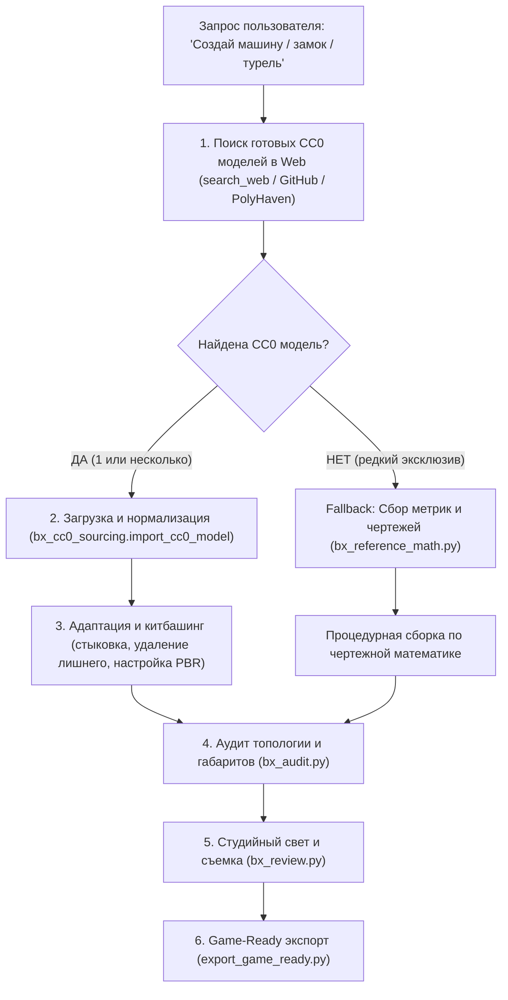

# Blender MCP Expert & Studio Pipeline (Стандарт студии)

Комплексный регламент профессиональной 3D-разработки через **Blender MCP**: жесткий приоритет поиска готовых **CC0 / Public Domain 3D-моделей** в интернете, многокомпонентный китбашинг, надежный `bpy`-код без сбоев версий, строгий аудит геометрии и автоматизированный Game-Ready экспорт.

---

## 0. Закон №1 Студии: CC0 Asset Sourcing & Kitbash First (Запрет слепого моделирования)

При запросе создания **абсолютно любого 3D-объекта** (автомобиль, здание, оружие, персонаж, пропс, природа) агент **ОБЯЗАН** первым делом найти в интернете готовую **CC0 / Public Domain 3D-модель** (или несколько моделей для китбашинга) и строить результат на ее основе, а не писать код геометрии «из головы».



### Порядок действий при любом запросе:
1. **Поиск CC0 моделей в открытых источниках (`search_web`)**:
   - Паттерн поискового запроса:
     `"<object name>" 3D model ("glb" OR "gltf") ("cc0" OR "public domain" OR site:github.com OR site:kenney.nl OR site:polyhaven.com OR site:poly.pizza)`
   - Основные бесплатные репозитории:
     * **Khronos Sample Assets** (официальные PBR/CC0 модели: автомобили, окружение, механизмы).
     * **Kenney NL** (сотни бесплатных CC0 наборов: Car Kit, Racing Kit, Platformer, Space, Weapons).
     * **Poly Haven** (100% CC0 модели, текстуры и HDRIs через `search_polyhaven_assets` / direct API).
     * **Poly Pizza & Sketchfab** (CC0 / Public domain пропсы).
     * **GitHub 3D Repositories** (прямые raw-ссылки на `.glb`).

2. **Загрузка и нормализация через `bx_cc0_sourcing.py`**:
   - Не писать громоздкие скрипты загрузки вручную — использовать студийный хелпер:
     ```python
     import sys, os; sys.path.append(os.path.join(os.environ.get("USERPROFILE", os.path.expanduser("~")), ".gemini", "config", "skills", "blender-mcp-expert", "scripts"))
     import bx_cc0_sourcing
     root, objs = bx_cc0_sourcing.import_cc0_model(
         file_path_or_url="<URL или локальный путь к .glb>",
         asset_name="TargetAsset",
         target_length_y=4.5 # или target_max_dimension в метрах
     )
     ```
   - Модуль автоматически скачивает файл в кэш, изолирует в отдельную коллекцию, масштабирует в реальные физические метры, центрирует и выставляет нижнюю точку строго на пол ($Z=0$).

3. **Китбашинг и адаптация (Single / Multi-Model Assembly)**:
   - **Опора на геометрию донора**: Агент изучает дочерние меши импортированной модели (`root.children`), использует готовую чистую сетку, UV-развертки и топологию.
   - **Удаление лишнего**: Если модель содержит вспомогательные объекты (подставки, фоны, скатерти), они удаляются.
   - **Комбинирование нескольких моделей (Китбашинг)**: Для сложных составных задач (например, *«тактический пикап с пулеметом»*) агент находит 2 CC0 модели (пикап + пулемет), импортирует обе и объединяет через `bx_cc0_sourcing.kitbash_assemble(base_root, {weapon_root: (0, 1.2, 1.5, 0.8)})`.
   - **Настройка материалов**: Подгонка базовых цветов шейдеров `BSDF_PRINCIPLED` под требования пользователя.

4. **Крайний Fallback (Только если CC0 нет в природе)**:
   - Если исчерпывающий поиск не дал подходящих CC0 моделей, агент применяет параметрическую чертежную математику `bx_reference_math.py` с жесткой фиксацией метрического паспорта ($L, W, H, W_b$).

---

## 1. Фундаментальные инварианты безопасного `bpy`

При вызове `call_mcp_tool(ServerName: "blender", ToolName: "execute_blender_code", Arguments: {code: "..."})` соблюдать 5 правил надежности:

1. **Поиск шейдерных нод строго по типу (`type`), а не по имени (`name`)**:
   В неанглоязычных версиях Blender названия нод локализуются (`nodes["Principled BSDF"]` возвращает `None`).
   ```python
   # ПРАВИЛЬНО:
   principled = next((n for n in mat.node_tree.nodes if n.type == "BSDF_PRINCIPLED"), None)
   ```

2. **Безопасные Enum'ы (Dynamic RNA Enum Safety)**:
   Идентификаторы меняются между версиями Blender. Читать допустимые значения динамически.

3. **PBR-параметры задаются на входах шейдера**:
   Свойство `material.diffuse_color` управляет только цветом сетки во вьюпорте и игнорируется рендером. Цвета, металличность и шероховатость задавать на сокетах ноды `BSDF_PRINCIPLED`:
   ```python
   base_color_socket = principled.inputs['Base Color'] if 'Base Color' in principled.inputs else principled.inputs[0]
   base_color_socket.default_value = (0.8, 0.05, 0.05, 1.0)
   ```

4. **Метрический контракт (Game-Ready Metrics)**:
   * **Пивот напольных объектов**: Origin строго в нижней точке ($Z = 0$ в Blender $\rightarrow$ $Y = 0$ в Godot/Three.js).
   * **Масштаб**: Все трансформации применяются (`Scale = (1, 1, 1)`).
   * **Лицевая сторона**: В Blender объект направлен вперед по оси $-Y$ (при экспорте с `export_yup=True` автоматически становится $-Z$).

5. **Визуальная верификация**:
   После любых изменений вызывать `bx_review.setup_review_camera("ISO")` и `get_viewport_screenshot` для подтверждения геометрии и материалов.

---

## 2. Набор встроенных инструментов (Studio Helpers)

В папке `scripts/` скилла находятся готовые модули:

### 1. `scripts/bx_cc0_sourcing.py` (Поиск, загрузка, нормализация и китбашинг CC0)
Главный инструмент работы с 3D-ассетами. Автоматически скачивает модели из веба, масштабирует, центрирует, сажает на $Z=0$ и объединяет в китбаш:
```python
import sys, os; sys.path.append(os.path.join(os.environ.get("USERPROFILE", os.path.expanduser("~")), ".gemini", "config", "skills", "blender-mcp-expert", "scripts"))
import bx_cc0_sourcing
root, objs = bx_cc0_sourcing.import_cc0_model(url, asset_name="MyAsset", target_max_dimension=3.0)
```

### 2. `scripts/bx_review.py` (Студийный свет, ракурсы и превью материалов)
Выставляет трехточечный свет, включает Material Preview, скрывает служебные оверлеи и наводит камеру на объект:
```python
import sys, os; sys.path.append(os.path.join(os.environ.get("USERPROFILE", os.path.expanduser("~")), ".gemini", "config", "skills", "blender-mcp-expert", "scripts"))
import bx_review
bx_review.setup_review_camera(viewpoint="ISO") # Доступно: 'ISO', 'FRONT', 'SIDE', 'TOP'
```

### 3. `scripts/bx_audit.py` (Аудит топологии)
Проверяет сцену на non-manifold ребра, висячие вершины, N-угольники, непримененные трансформации и отрыв от пола ($Z = 0$):
```python
import sys, os; sys.path.append(os.path.join(os.environ.get("USERPROFILE", os.path.expanduser("~")), ".gemini", "config", "skills", "blender-mcp-expert", "scripts"))
import bx_audit
report = bx_audit.audit_scene()
```

### 4. `scripts/bx_reference_math.py` (Чертежная математика и параметрический Fallback)
Используется как fallback для транспорта при отсутствии готовых CC0 моделей в сети.

### 5. `scripts/export_game_ready.py` (Экспорт в движок)
Автоматически сдвигает геометрию к полу ($Z=0$), применяет масштабы, выворачивает нормали наружу и экспортирует оптимизированный `.glb` и мастер-файл `.blend`:
```python
import sys, os; sys.path.append(os.path.join(os.environ.get("USERPROFILE", os.path.expanduser("~")), ".gemini", "config", "skills", "blender-mcp-expert", "scripts"))
import export_game_ready
export_game_ready.prepare_and_export_game_ready(
    export_glb_path=r"res://assets/models/my_vehicle.glb",
    save_blend_path=r"res://assets/models/my_vehicle.blend",
    pivot_mode="BOTTOM"
)
```

---

## 3. Специализированный субагент `blender_3d_artist`

При необходимости передать задачу по 3D-моделированию отдельному агенту:
1. Вызвать `define_subagent`:
   * **Name**: `blender_3d_artist`
   * **Role**: 3D Artist / CC0 Ingestion & Kitbash Specialist
   * **System Prompt**: Обязательно включает требования: (1) поиск готовых CC0 моделей в сети (`search_web`, GitHub, Poly Haven, Kenney), (2) загрузка и нормализация через `bx_cc0_sourcing.py`, (3) сборка/китбашинг и адаптация под ТЗ, (4) проверка через `bx_audit.py` и `get_viewport_screenshot`.
   * **enable_mcp_tools**: `true`
   * **enable_write_tools**: `true`
2. Запустить субагента через `invoke_subagent`.
