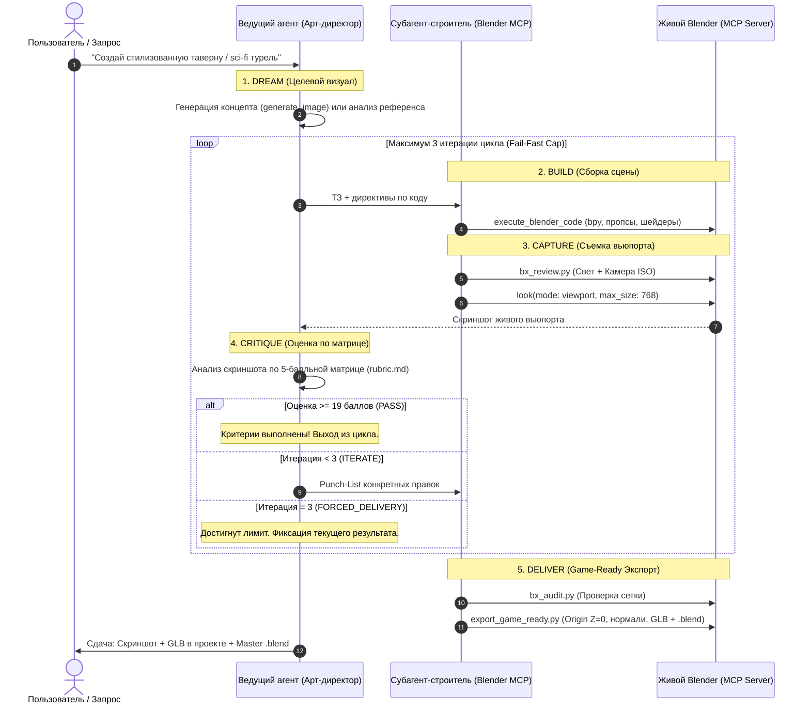

# Autonomous Dream-Loop Pipeline (Стандарт визуальной доводки)

Замкнутый автономный цикл итеративного 3D-моделирования в Blender MCP, вдохновленный концепцией `dream-loop` и стандартами визуального контроля ведущих игровых студий.

---

## 1. Архитектура замкнутого цикла (Closed-Loop Workflow)



---

## 2. Фазы выполнения

### Фаза 1: DREAM (Поиск готовых CC0 моделей и фиксация ориентиров)
1. **Поиск CC0 моделей в сети (`search_web`)**:
   Для абсолютно любого объекта (транспорт, архитектура, пропс, персонаж, оружие) ведущий агент **обязательно** выполняет поиск готовых **CC0 / Public Domain** 3D-моделей в открытых репозиториях (Khronos, Kenney, Poly Haven, Poly Pizza, GitHub).
2. **Многокомпонентный подбор (Kitbash Discovery)**:
   Если объект сложный, агент находит 1 или несколько моделей-доноров (например, шасси + надстройка, корпус + обвес).
3. **Фиксация габаритов в метрах**:
   Определяются целевые габариты ($L, W, H$) и привязка к полу ($Z = 0$).

### Фаза 2: BUILD (Импорт CC0, нормализация и китбашинг через Blender MCP)
Субагент `blender_3d_artist` (предварительно объявленный через `define_subagent` с `enable_mcp_tools: true` и `enable_write_tools: true`) либо основной агент:
1. Импортирует найденную модель (модели) через `bx_cc0_sourcing.import_cc0_model(url, asset_name, target_size)` или нативный MCP tool `import_asset`.
2. Очищает служебную геометрию, подставки, настраивает PBR-материалы (`BSDF_PRINCIPLED`).
3. При необходимости стыкует дополнительные CC0-компоненты через `bx_cc0_sourcing.kitbash_assemble`.
4. Только при полном отсутствии CC0 моделей переходит к процедурной fallback-сборке.

### Фаза 3: CAPTURE (Постановка света и съемка)
1. Выполняется скрипт студийного света и ракурса:
   ```python
   import sys, os
   scripts_dir = os.path.join(os.environ.get("USERPROFILE", os.path.expanduser("~")), ".gemini", "config", "skills", "blender-mcp-expert", "scripts")
   if scripts_dir not in sys.path:
       sys.path.append(scripts_dir)
   import bx_review
   bx_review.setup_review_camera("ISO")
   ```
2. Вызывается инструмент съемки:
   `call_mcp_tool(ServerName: "blender", ToolName: "look", Arguments: {"mode": "viewport", "max_size": 768})`.

### Фаза 4: CRITIQUE (Визуальная критика по матрице)
Ведущий агент (Арт-директор) сопоставляет полученный скриншот с концептом по [Матрице рубрик](./references/rubric.md):
* **Силуэт и габариты** (1-5)
* **Свет и читаемость** (1-5)
* **Материалы и шейдинг** (1-5)
* **Чистота сетки и отсутствие артефактов** (1-5)
* **Соответствие исходному стилю** (1-5)

Если суммарный балл $\ge 19$ из 25 — переход к экспорту. Иначе составляется список точечных правок (Punch-List).

### Фаза 5: REFINE & FAIL-FAST LIMITS
* **СТРОГИЙ ЛИМИТ**: Не более **3 итераций** доработки.
* Каждая итерация исправляет только пункты из Punch-List, не переписывая всю сцену с нуля.

### Фаза 6: DELIVER (Сдача результата)
1. Вызов `bx_audit.py` для подтверждения целостности сетки.
2. Вызов `export_game_ready.py`:
   - Напольный пивот выставляется на $Z=0$;
   - Применяются трансформации;
   - Сохраняются `.glb` и `.blend`;
3. Отчет пользователю с итоговым скриншотом и путями к артефактам.
