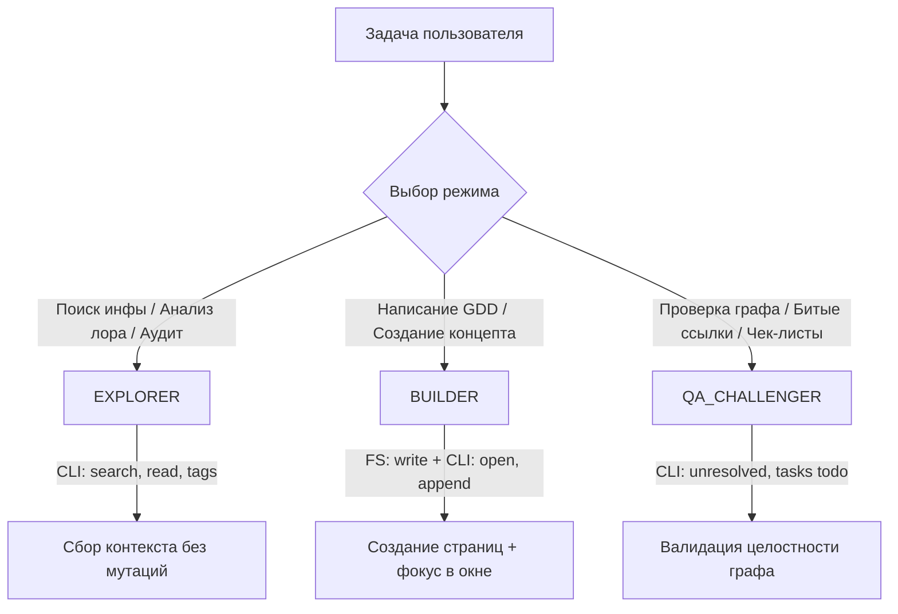

# Obsidian Studio Integration Standard (`obsidian-studio`)

Стандарт студии по интеграции ИИ-агентов с Obsidian Vault: прямое управление через официальный CLI, ведение дизайн-документов (GDD), нарративной базы знаний, графа связей и списков задач.

---

## 1. Архитектура интеграции

### Двухуровневый доступ:
1. **Уровень интерфейса и рантайма (Obsidian CLI)**:
   - Исполняемый файл: `Obsidian.com` (зарегистрирован в PATH как `obsidian`, путь по умолчанию: `F:\obsidian\Obsidian.com`).
   - Используется для интерактивных действий: открытие вкладок перед пользователем (`open`), полнотекстовый поиск (`search`), сбор невыполненных задач (`tasks todo`), проверка целостности ссылок (`unresolved`).
   - Для вызовов из PowerShell всегда форсировать UTF-8:
     ```powershell
     [Console]::OutputEncoding = [System.Text.Encoding]::UTF8
     & "F:\obsidian\Obsidian.com" <command> [args]
     ```
2. **Уровень файловой системы (Direct FS)**:
   - Расположение активного Vault по умолчанию: `C:\Users\Денис\Documents\Obsidian Vault`.
   - Динамическое получение пути: `& "F:\obsidian\Obsidian.com" vault info=path`.
   - Используется для быстрого пакетного создания и редактирования сложных `.md` файлов через нативные инструменты агента (`write_to_file`, `replace_file_content`, `view_file`).

---

## 2. Связка с режимами работы (`agent-modes`)

При работе с базой знаний агент синхронизирует действия с активным режимом:



### 1. Режим `EXPLORER`:
- Команды: `obsidian search query="<текст>" format=json`, `obsidian tags verbose`, `obsidian read path="<путь>"`.
- Назначение: Быстро найти, как в существующих диздоках описана механика, проверить терминологию персонажей или статус фичи.

### 2. Режим `BUILDER`:
- Команды: Создание файлов на диске -> команда `obsidian open file="<имя>"` (чтобы заметка сразу открылась в приложении у пользователя).
- Назначение: Генерация GDD, механик, веток диалогов, лора фракций.
- Инвариант: Каждая новая заметка обязана содержать двусторонние ссылки `[[...]]` и быть привязана к родительскому разделу или MOC (Map of Content).

### 3. Режим `QA_CHALLENGER`:
- Команды: `obsidian unresolved verbose` (поиск «висячих» ссылок без файлов), `obsidian tasks todo verbose`.
- Назначение: Аудит базы знаний — выявление незакрытых задач спринта и несуществующих страниц, на которые есть ссылки.

---

## 3. Стандарты оформления заметок студии

Каждая создаваемая в Obsidian заметка должна соответствовать стандарту качества:

### 1. Обязательный YAML Frontmatter:
```markdown
---
type: gdd | lore | mechanic | character | task | moc
status: draft | in-progress | reviewed | approved
tags:
  - game-design
  - core-loop
created: YYYY-MM-DD
updated: YYYY-MM-DD
author: Studio Team
---
```

### 2. Структура и перелинковка (Wiki-links):
- Названия файлов — латиница или читаемая кириллица без запрещенных символов (`:`, `/`, `\`, `?`, `*`).
- Ключевые термины, предметы, персонажи и связанные системы всегда оборачиваются в `[[Имя заметки]]`.
- Для обратной навигации в шапке каждой заметки указывать родительский узел: `[[00_Dashboard|<- Главная]] | [[MOC - Механики|<- Раздел механик]]`.

### 3. Нативная визуализация:
- **Mermaid-схемы** для логики, лупов геймплея и стейт-машин (`graph TD`, `sequenceDiagram`, `stateDiagram-v2`).
- **Callouts Obsidian** для расстановки акцентов:
  ```markdown
  > [!NOTE] Архитектурная заметка
  > [!TIP] Совет по геймдизайну или балансу
  > [!WARNING] Техническое ограничение или риск для производительности
  > [!IMPORTANT] Ключевой инвариант механики
  ```
- **Интерактивные чек-листы** для задач разработчиков и QA:
  ```markdown
  - [ ] Разработать контроллер перемещения
  - [ ] Протестировать граничные случаи коллизий
  ```

---

## 4. Памятка по ключевым командам Obsidian CLI

| Команда | Описание | Пример вызова |
| :--- | :--- | :--- |
| `vault` | Информация о текущем хранилище | `& "F:\obsidian\Obsidian.com" vault verbose` |
| `open` | Открыть заметку во вкладке Obsidian | `& "F:\obsidian\Obsidian.com" open file="Combat_System.md"` |
| `read` | Прочитать содержимое заметки через CLI | `& "F:\obsidian\Obsidian.com" read file="Combat_System.md"` |
| `search` | Поиск текста по всему Vault | `& "F:\obsidian\Obsidian.com" search query="Мана" format=json` |
| `tags` | Список всех используемых тегов | `& "F:\obsidian\Obsidian.com" tags counts` |
| `tasks` | Список задач с фильтрацией | `& "F:\obsidian\Obsidian.com" tasks todo verbose` |
| `task` | Переключить статус конкретной задачи | `& "F:\obsidian\Obsidian.com" task ref="Tasks.md:14" toggle` |
| `unresolved` | Список ссылок на еще не созданные файлы | `& "F:\obsidian\Obsidian.com" unresolved verbose` |
| `eval` | Выполнить JS в контексте Obsidian API | `& "F:\obsidian\Obsidian.com" eval code="app.vault.getName()"` |

---

## 5. Типовая структура папок в Vault студии

При инициализации игрового проекта в хранилище создается рекомендованная иерархия:

```text
📁 Obsidian Vault/
├── 📄 00_Dashboard.md           # Главный хаб (MOC), ссылки на все разделы и статус проекта
├── 📁 01_Vision_Core/           # Питч, ЦА, USP, Core Gameplay Loop
├── 📁 02_Mechanics/             # Системы (боевая, инвентарь, прокачка, крафт)
├── 📁 03_Lore_Narrative/        # Сюжет, мир, персонажи, фракции, диалоги
├── 📁 04_Architecture_Code/     # Технические спеки, API, схемы узлов Godot/Unity
├── 📁 05_Art_Audio/             # Визуальный стиль, референсы, звуковой дизайн
├── 📁 06_Tasks_QA/              # Спринты, тест-планы, баг-трекинг
└── 📁 _Templates/               # Шаблоны заметок для быстрого создания
```
