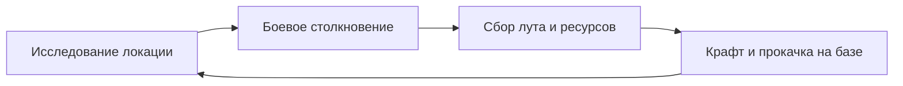

# 🎮 {{project_name}} — Game Hub

> [!NOTE] Статус проекта
> Проект находится на стадии раннего прототипирования.
> Движок: Godot 4.x / Unity / Unreal

---

## 🗺️ Карта разделов (Map of Content)

- 🌟 **Вижн и концепция**: [[01_Vision_Core/Game_Pitch|Питч игры]] | [[01_Vision_Core/Core_Loop|Core Gameplay Loop]]
- ⚙️ **Механики и системы**: [[02_Mechanics/Movement|Управление]] | [[02_Mechanics/Combat|Боевая система]] | [[02_Mechanics/Inventory|Инвентарь]]
- 📜 **Нарратив и мир**: [[03_Lore_Narrative/World_Overview|Мир игры]] | [[03_Lore_Narrative/Factions|Фракции]] | [[03_Lore_Narrative/Characters|Персонажи]]
- 💻 **Архитектура и код**: [[04_Architecture_Code/Architecture_Overview|Обзор архитектуры]] | [[04_Architecture_Code/Node_Hierarchy|Дерево сцен]]
- 🎨 **Арт и SFX**: [[05_Art_Audio/Art_Style|Визуальный стиль]] | [[05_Art_Audio/Audio_Design|Звук и музыка]]
- 📋 **Задачи и QA**: [[06_Tasks_QA/Current_Sprint|Текущий спринт]] | [[06_Tasks_QA/Test_Checklist|Чек-лист тестирования]]

---

## 🔄 Core Gameplay Loop

---

## 📌 Задачи в фокусе (To-Do)

- [ ] Утвердить финальный питч игры
- [ ] Собрать прототип контроллера игрока
- [ ] Протестировать базовый геймплейный цикл
