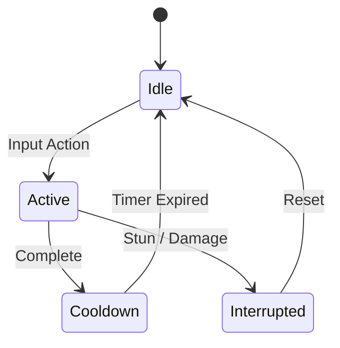

# ⚔️ Механика: {{mechanic_name}}

[[00_Dashboard|<- Назад в Dashboard]] | [[02_Mechanics/Overview|<- Все механики]]

> [!IMPORTANT] Цель механики
> Кратко описать, какую эмоцию и вызов механика дает игроку.

---

## 1. Описание и правила
- **Входное условие (Trigger)**: Что запускает механику (нажатие кнопки, область триггера, событие таймера).
- **Процесс (Action)**: Что происходит во время действия.
- **Результат (Outcome)**: Вознаграждение, штраф или изменение состояния персонажа/мира.

---

## 2. Параметры и баланс

| Параметр | Значение по умолчанию | Диапазон (@export_range) | Ед. изм. | Описание |
| :--- | :--- | :--- | :--- | :--- |
| `cooldown` | 2.5 | 0.5 - 10.0 (шаг 0.1) | сек | Время перезарядки |
| `cost` | 15.0 | 0.0 - 100.0 | ед | Расход выносливости / маны |

---

## 3. Стейт-машина / Логика

---

## 4. Граничные случаи и риски (QA Checklist)

> [!WARNING] Зона внимания тестеров
> - [ ] Прерывание действия получением урона или оглушением.
> - [ ] Спам кнопки ввода во время анимации (буферизация ввода).
> - [ ] Поведение при нулевом запасе ресурсов (маны/выносливости).
