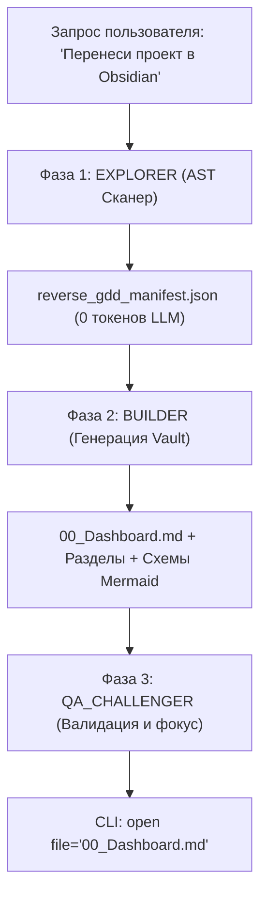

# Reverse-GDD: Перенос и документирование существующего проекта в Obsidian (`reverse-gdd`)

Стандарт студии по автоматическому переносу существующей кодовой базы игры в живую, взаимосвязанную базу знаний (Game Design Document & Architecture Hub) в Obsidian.

---

## 1. Концепция и цели

Когда у проекта уже есть рабочий код, но нет актуальной документации, **Reverse-GDD** решает три задачи:
1. **Визуализация реальной архитектуры**: Превращает классы, сцены и сигналы в интерактивный граф связей в Obsidian (`Ctrl + G`).
2. **Экстракция баланса и механик**: Вытягивает все параметры конфигурации (`@export`, константы, формулы) в удобные таблицы геймдизайна.
3. **Аудит техдолга**: Собирает разбросанные по коду `# TODO`, `# FIXME` и сомнительные участки в единый интерактивный трекер задач `- [ ]`.

---

## 2. Пайплайн выполнения (3-фазный цикл)



---

### Фаза 1: Сканирование кодовой базы (`EXPLORER` Mode)
* **Принцип**: **Строгая токеноэкономия**. Запрещено построчно читать сотни файлов исходного кода через контекст модели.
* **Действие**: Запустить локальный сканер AST/Regex:
  ```powershell
  python "C:\Users\Денис\.gemini\config\skills\reverse-gdd\scripts\scan_project.py" "<путь_к_проекту>" "scratch\reverse_gdd_manifest.json"
  ```
* **Результат**: Манифест содержит:
  - Список всех модулей и классов (`class_name`, наследование `extends`);
  - Все переменные конфигурации и баланса (`@export` с типами и значениями по умолчанию);
  - Сигналы и события (`signal`);
  - Иерархии сцен Godot (`.tscn`) или скриптов;
  - Все найденные метки `# TODO` / `# FIXME`.

---

### Фаза 2: Синтез и генерация базы знаний (`BUILDER` Mode)
* **Определение целевого хранилища**:
  Узнать путь к активному Vault через CLI:
  ```powershell
  & "F:\obsidian\Obsidian.com" vault info=path
  ```
  *(По умолчанию: `C:\Users\Денис\Documents\Obsidian Vault`)*.

* **Генерация структуры папок и файлов**:
  Внутри Vault создается чистая иерархия:

  1. **`00_Dashboard.md`** (Главный навигатор / MOC):
     - Название проекта, движок, дата реверса;
     - Ссылки на ключевые разделы;
     - Mermaid-схема верхнеуровневого игрового цикла (Core Gameplay Loop);
     - Сводка ключевых метрик (кол-во систем, сцен, открытых задач).

  2. **`01_Architecture/`**:
     - `Architecture_Overview.md` — общая архитектура, связи компонентов и синглтонов;
     - `Event_Bus_Signals.md` — таблица всех сигналов проекта и кто на них подписан;
     - `Scenes_Hierarchy.md` — обзор сцен и связанных префабов.

  3. **`02_Mechanics/`**:
     - Заметки по каждой выявленной механике (`Movement.md`, `Combat.md`, `Inventory.md`);
     - Каждая заметка содержит таблицу извлеченных параметров `@export`:
       | Параметр | Тип | Дефолт | Назначение |
       | :--- | :--- | :--- | :--- |
     - Mermaid-схема состояний или логики выполнения.

  4. **`03_Entities/`**:
     - Карточки сущностей (`Player.md`, `EnemyBase.md`, `ItemData.md`);
     - Двусторонние вики-ссылки `[[...]]` на связанные механики и архитектурные узлы.

  5. **`04_Tasks_Refactor/`**:
     - `TODO_Tracker.md` — все найденные в коде `# TODO` и `# FIXME`, разбитые по файлам с интерактивными чекбоксами `- [ ]`;
     - `Technical_Debt_Audit.md` — рекомендации техлида и QA по улучшению архитектуры.

---

### Фаза 3: Валидация и презентация (`QA_CHALLENGER` Mode)
1. **Проверка целостности ссылок**:
   Запустить проверку через CLI:
   ```powershell
   & "F:\obsidian\Obsidian.com" unresolved verbose
   ```
   Убедиться, что нет «висячих» ссылок без созданных страниц.
2. **Фокусировка экрана пользователя**:
   Открыть сгенерированный главный экран прямо в приложении Obsidian:
   ```powershell
   & "F:\obsidian\Obsidian.com" open file="00_Dashboard.md"
   ```
3. **Отчет**:
   Кратко доложить пользователю объем проделанной работы: сколько модулей оцифровано, сколько механик вынесено и какие задачи требуют внимания.

---

## 3. Стандарты форматирования для Reverse-GDD

* **YAML Frontmatter**: Обязателен во всех файлах с полями `type`, `source_file`, `tags`, `status: reverse-engineered`.
* **Двусторонняя связность**: Каждая сущность ссылается на свои зависимости и на `[[00_Dashboard]]`.
* **Zero-Hallucination**: Опираться строго на факты из кода (реальные имена переменных и дефолтные числа). Никаких выдуманных параметров.
