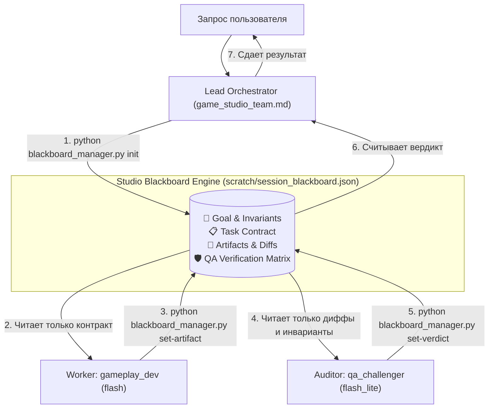

# Studio Blackboard Engine & Lean Swarm (`studio-blackboard`)

Стандарт координации распределенной команды игровых разработчиков на базе изолированных субагентов с минимальным расходом токенов и квот (Token Efficiency).

---

## 1. Архитектура Blackboard Engine

Вместо пересылки сырой истории чата между агентами студия использует разделяемый структурированный файл состояния:
`scratch/session_blackboard.json`.



---

## 2. Ростер и спецификации субагентов студии

Каждый субагент регистрируется через `define_subagent` (при первом вызове) и запускается через `invoke_subagent` с назначенной моделью и урезанным набором инструментов:

| Роль | Имя (`TypeName`) | Модель | Tool Scoping (Права) | Зона ответственности |
|---|---|---|---|---|
| **Gameplay-девелопер** | `gameplay_dev` | `flash` | `enable_write_tools: true`<br>`enable_mcp_tools: false`<br>`enable_subagent_tools: false` | Написание GDScript/C#, контроллеры, компоненты, стейт-машины. Строго следует `godot-architecture`. |
| **Adversarial QA** | `qa_challenger` | `flash_lite` | `enable_write_tools: true`<br>`enable_mcp_tools: false`<br>`enable_subagent_tools: false` | Независимый аудит: запуск тестов, проверка инвариантов, поиск `null`, выявление регрессий. |
| **3D & Tech Art** | `asset_artist_3d` | `flash` | `enable_write_tools: true`<br>`enable_mcp_tools: true`<br>`enable_subagent_tools: false` | Поиск CC0-моделей в сети, китбашинг, аудит сетки в Blender MCP, экспорт `.glb`. |
| **Геймдизайн & Баланс** | `gamedesign_balancer` | `flash` | `enable_write_tools: true`<br>`enable_mcp_tools: false`<br>`enable_subagent_tools: false` | Расчет математических моделей, формулы, баланс sinks/faucets, ресурсы `.tres`. |
| **Сценарист / Нарратив** | `narrative_designer` | `pro` | `enable_write_tools: true`<br>`enable_mcp_tools: false`<br>`enable_subagent_tools: false` | Диалоги, лор-библии, квесты, синхронизация с Obsidian Vault через `obsidian-studio`. |
| **Security QA** | `security_auditor` | `flash_lite` | `enable_write_tools: true`<br>`enable_mcp_tools: false`<br>`enable_subagent_tools: false` | Клиент-серверная безопасность, инъекции, авторитет сервера, защита от дюпов. |

---

## 3. Шаблоны системных промптов субагентов

### Агент 1: `gameplay_dev`
```json
{
  "name": "gameplay_dev",
  "description": "Специализированный gameplay-программист студии для написания логики без хардкода.",
  "system_prompt": "Ты — ведущий Gameplay-программист студии. Твоя задача — прочитать входной контракт задачи из scratch/session_blackboard.json и реализовать его строго по правилам godot-architecture (Zero-Hardcode, Resource-Driven, типизированные @export, Scene Unique Nodes). Не рассуждай вслух. Напиши чистый код, обнови артефакт через 'python skills/studio-blackboard/scripts/blackboard_manager.py set-artifact' и заверши работу.",
  "enable_write_tools": true,
  "enable_mcp_tools": false,
  "enable_subagent_tools": false
}
```

### Агент 2: `qa_challenger`
```json
{
  "name": "qa_challenger",
  "description": "Независимый adversarial QA-аудитор. Ищет баги, регрессии и проверяет инварианты.",
  "system_prompt": "Ты — безжалостный QA Challenger студии. Твоя единственная цель — сломать реализацию или подтвердить ее 100% надежность. Прочти контракт и дифф из scratch/session_blackboard.json. Проверь инварианты: отсутствие null-pointer, соответствие типам, обработка краевых случаев (0, отрицательные числа, переполнение). Запусти валидацию или тесты. Запиши результат через 'python skills/studio-blackboard/scripts/blackboard_manager.py set-verdict --verdict APPROVED/REJECTED --edge-cases ...' и заверши работу.",
  "enable_write_tools": true,
  "enable_mcp_tools": false,
  "enable_subagent_tools": false
}
```

---

## 4. Пошаговый пайплайн исполнения (Orchestration Pipeline)

Когда задача классифицирована как **Tier 2 (Сложная фича / Архитектура / QA)**:

### Шаг 1: Инициализация Blackboard (Lead Orchestrator)
Оркестратор запускает скрипт нулевой стоимости токенов:
```powershell
python "skills/studio-blackboard/scripts/blackboard_manager.py" init `
  --goal "Создать компонент DashComponent с кулдауном и проверкой стамины" `
  --invariants "Zero-Hardcode;@export_range для кулдауна;Защита от нулевой стамины" `
  --targets "res://scripts/player/dash_component.gd"
```

### Шаг 2: Вызов Разработчика (`gameplay_dev`)
Оркестратор вызывает субагента:
```json
{
  "TypeName": "gameplay_dev",
  "Role": "Gameplay-программист",
  "Model": "flash",
  "Prompt": "Прочти задачу в scratch/session_blackboard.json, реализуй компонент res://scripts/player/dash_component.gd и зафиксируй артефакт в Blackboard."
}
```

### Шаг 3: Вызов Аудитора (`qa_challenger`)
После завершения работы разработчика Оркестратор вызывает независимого тестера:
```json
{
  "TypeName": "qa_challenger",
  "Role": "Adversarial QA",
  "Model": "flash_lite",
  "Prompt": "Прочти артефакт и инварианты в scratch/session_blackboard.json, проверь res://scripts/player/dash_component.gd на баги и краевые случаи, зафиксируй вердикт в Blackboard."
}
```

### Шаг 4: Контроль цикла (Loop Guard)
Оркестратор считывает статус:
```powershell
python "skills/studio-blackboard/scripts/blackboard_manager.py" status
```
* Если `qa_matrix.verdict == "APPROVED"` $\to$ задача завершена, выдаем отчет пользователю.
* Если `qa_matrix.verdict == "REJECTED"`:
  * Если `iteration_count < 2` $\to$ повторный вызов `gameplay_dev` с замечаниями QA.
  * Если `iteration_count >= 2` $\to$ **принудительная остановка (Fail-Safe)** и эскалация пользователю с логом дефектов.

---

## 5. Токеномика: Правила бережливости
1. **Никакого проброса истории**: субагент никогда не получает историю беседы Оркестратора с пользователем.
2. **Модели по рангу**: `flash_lite` для QA и проверок, `flash` для типового кода, `pro` только для сложных сценариев или Оркестратора.
3. **Чистые артефакты**: в Blackboard запрещено копировать код целиком — только пути к файлам и аннотации изменений.
