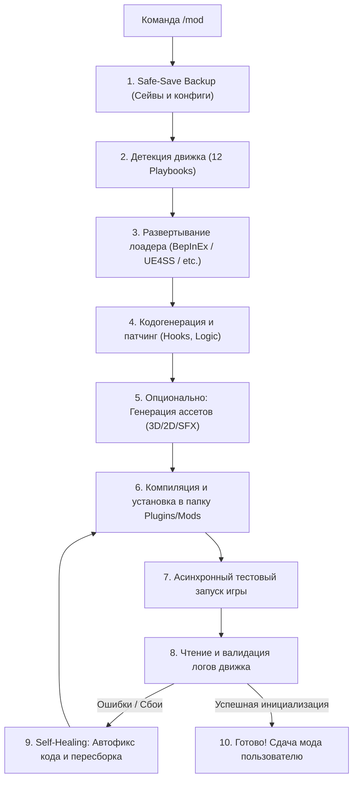

# Universal Modder: Автономный игровой модостроительный пайплайн (`/mod`)

Профессиональный агентный регламент реверс-инжиниринга, внедрения загрузчиков модов, кодогенерации и создания ассетов для ПК-игр на базе архитектуры Universal Modder.

---

## 1. Правило триггера и строгой изоляции
* **Скил спит по умолчанию.** Запрещено вызывать его превентивно при общих разговорах об играх, геймдеве или кодинге.
* **Команды и фразы активации:**
  > `/mod` или `/universal-modder`
  > `/mod <путь_к_игре> <описание_мода>`
  > Прямой запрос: «создай мод для игры <путь>» / «внедри мод в игру»

---

## 2. Железные ограничения безопасности (Safety Guardrails)
Перед выполнением любых действий агент ОБЯЗАН проверить следующие инварианты:
1. **Anti-Cheat Veto (Запрет на мультиплеер):**
   * Если в папке с игрой обнаружены следы античитов (`EasyAntiCheat`, `BattlEye`, `Vanguard`, `Denuvo`, `Ricochet`) или игра является строго сессионным онлайн-мультиплеером — **НЕМЕДЛЕННО ПРЕРВАТЬ РАБОТУ** и уведомить пользователя.
   * Создание сетевых читов, аимботов, валлхаков и эксплойтов строго запрещено.
2. **Safe-Save Snapshot (Защита сохранений):**
   * Перед любым патчингом или установкой лоадера автоматически создать резервную копию папки с сохранениями (`%USERPROFILE%/Saved Games`, `%APPDATA%`, `%LOCALAPPDATA%` или внутренняя папка `saves/`) и оригинальных исполняемых файлов в директорию `_ModderBackup/`.
3. **Non-blocking Execution (Безопасный запуск):**
   * Запуск игры для тестирования производить строго в асинхронном неблокирующем режиме (через фоновые задачи или `Start-Process`), чтобы не заблокировать терминал сессии.

---

## 3. Матрица детекции движков (12 Engine Playbooks)

При получении пути к игре агент сканирует файлы и директории по сигнатурам:

| Движок | Сигнатуры в папке игры | Стек модификации | Специфика сборки |
| :--- | :--- | :--- | :--- |
| **1. Unity (Mono)** | `UnityPlayer.dll`, папка `*_Data/Managed/Assembly-CSharp.dll` | **BepInEx 5.x**, **HarmonyX** | C# плагин, хуки на методы классов через Harmony Prefix/Postfix |
| **2. Unity (IL2CPP)** | `UnityPlayer.dll`, `il2cpp_data`, `GameAssembly.dll` | **BepInEx 6.x (IL2CPP)** или **MelonLoader** | C# через генерацию Unhollower/Cpp2IL прокси-классов |
| **3. Unreal Engine 4/5** | Папка `Engine/Binaries/Win64`, `*.pak`, `*.ucas`, `*Uproject*` | **UE4SS** (Unreal Engine Scripting System) | Lua / C++ DLL, перехват UObject и Blueprints |
| **4. Bethesda (Creation)** | `TESV.exe`, `Fallout4.exe`, `Starfield.exe`, файлы `.esm`/`.ba2` | **SKSE / F4SE / SFSE** | Скрипты Papyrus, плагины интерфейса (SWF/Scaleform), C++ DLL |
| **5. Source Engine** | `hl2.exe`, `portal2.exe`, папка `bin/engine.dll`, `*.vpk` | **SourceHook, Metamod, VScript** | Патчинг библиотек, C++, Squirrel/Lua скрипты |
| **6. Minecraft** | `minecraft.jar`, папки `.minecraft/versions` | **Fabric / Forge / NeoForge** | Java/Kotlin моды, сборка через Gradle / Mixin патчи |
| **7. Godot Engine** | Исполняемый файл + `*.pck`, сигнатура GDExec | **GDRE Tools / PCK Explorer** | Распаковка `.pck`, внедрение GDScript, перепаковка или GDExtension |
| **8. GameMaker** | `data.win`, `audiogroup*.dat` | **UndertaleModTool CLI** | Замена ассетов, декомпиляция и патчинг GML байткода |
| **9. FNA / XNA / MonoGame** | `FNA.dll`, `Terraria.exe`, `Celeste.exe` | **tModLoader**, **Everest**, **MonoMod** | MonoMod RuntimeDetour, C# сборки |
| **10. RPG Maker (MV/MZ)**| `package.json`, папка `www/js/plugins`, `nw.exe` | **JS Plugin Architecture** | Написание JavaScript плагина в `js/plugins/` с регистрацией в `plugins.js` |
| **11. Retro Decomps** | `sm64.*`, `soh.exe`, реверс-порты открытого C/C++ | **Native C Source Injection** | Добавление `.c` файлов в дерево сборки и перекомпиляция |
| **12. Native C/C++** | Кастомные бинарники без стандартных движков | **MinHook / Detours / DllProxy** | Создание Proxy DLL (`d3d11.dll` / `dxgi.dll` / `version.dll`) с инъекцией хуков памяти |

---

## 4. Пошаговый пайплайн выполнения команды `/mod`

### Этап 1: Инспекция и Бэкап
1. Просканировать путь игры. Найти основной `.exe`, определить архитектуру (`x86` vs `x64`).
2. Определить тип движка по сигнатурам.
3. Скопировать сохранения и оригинальные конфиги в безопасную папку `_ModderBackup/`.

### Этап 2: Установка загрузчика (Mod Loader Injection)
1. Если лоадер отсутствует:
   * **Unity**: Развернуть BepInEx соответствующей версии и архитектуры.
   * **Unreal**: Установить UE4SS в папку `Binaries/Win64/`.
   * **Bethesda**: Проверить наличие соответствующего Script Extender.
2. Сконфигурировать файл настроек лоадера (включить логирование консоли в файл).

### Этап 3: Кодогенерация логики
1. Написать изолированный плагин:
   * Для C# (Unity): класс, наследующий `BaseUnityPlugin`, с аннотациями `[BepInPlugin]`. Использовать **Harmony** для перехвата целевых методов.
   * Для Unreal: Lua-скрипт или C++ хук в директорию `ue4ss/Mods/<ModName>/scripts/main.lua`.
   * Для RPG Maker: JS-файл в `www/js/plugins/`.
2. Избегать жесткого перезаписывания исходных файлов игры — все изменения внедрять исключительно через **runtime-хуки** или **слои модов**.

### Этап 4: Ассеты (если запрошены)
1. Если моду требуются текстуры: создать или сгенерировать файлы с сохранением оригинальных пропорций и формата (PNG, DDS).
2. Если требуются звуки: конвертировать в WAV/OGG с частотой дискретизации движка (обычно 44100 Hz).

### Этап 5: Сборка, Запуск и Self-Healing
1. Скомпилировать мод (через `dotnet build`, `csc`, `gcc` или упаковку скрипта).
2. Поместить артефакт в целевую папку модов игры.
3. Выполнить **фоновый запуск** игры на 10-15 секунд для проверки инициализации.
4. Проверить лог-файлы (`BepInEx/LogOutput.log`, `UE4SS.log` и др.):
   * **Если есть ошибки (Exception, TypeMismatch, MissingMethod):** проанализировать стектрейс, скорректировать сигнатуру хука и пересобрать мод.
   * **Если инициализация прошла успешно (`Plugin loaded successfully`):** закрыть тестовый процесс (при необходимости) и сформировать отчет игроку.

---

## 5. Выходной отчет для пользователя
После завершения работы агент выводит краткую карточку:
1. **Игра и Движок:** Определенная платформа и архитектура.
2. **Установленный лоадер:** Что было внедрено (BepInEx, UE4SS и т.д.).
3. **Созданные файлы:** Список сгенерированных `.dll` / скриптов / ассетов.
4. **Управление модом:** Горячие клавиши, настройки в конфигах или описание механики в игре.
5. **Путь к бэкапу:** Где сохранены резервные копии на случай отката.
